# Сайт Менона: правки интерфейса (2026-11-15)

Выкачено на прод 2026-11-15: Meno-Web `main` a31b11a (ветка `fix/webui-polish`, 9ef684d), скрипт
`~/meno-v2/deploy_web4.sh`, откат `~/meno-v2/rollback_web4.sh`. Часть про недоступные модели требует бэкенда
Meno-Stand-RAG-Core `main` 5387a0c (ветка `fix/model-status`, 026d4b5; выкатка — `~/meno-v2/deploy_main5.sh`).

Скриншоты сняты в headless Chrome на экране телефона 390×844 и на десктопе 1280×860. Данные
выдуманные: мок-бэкенд отдаёт настоящие ответы `/v1/models`, `/v1/knowledge-bases` с прода и
заранее написанные потоки ответа (обычный ответ, ответ с ошибкой на стадии `prepare`).

Тесты: Meno-Web — 400 из 400 (38 файлов), eslint без новых предупреждений; бэкенд — весь набор
зелёный (1296 passed, 4 skipped), ruff чистый.

## Что было и что сделано

| Замечание | Причина | Что сделано |
|---|---|---|
| Нет кнопки «скопировать вопрос» | её не было | Под вопросом справа иконка копирования |
| «Скопировать ответ» появляется раньше ответа | кнопка рисовалась всегда, и во время генерации | Только у законченного ответа с текстом; копируется ответ без рассуждений модели |
| На телефоне страница прокручивается во все стороны | 1) поле отзыва 12.8 px — iOS приближает страницу при фокусе, после этого она ездит во все стороны; 2) открытое поле отзыва и подпись модели вылезали за край, у ленты появлялась горизонтальная прокрутка | Поле отзыва 16 px на сенсорных экранах; лента прокручивается только вертикально; поле отзыва уходит на свою строку; широкие таблицы прокручиваются в своей рамке |
| Дёргается во время генерации | крутящаяся фраза («Обращаюсь к мудрецам Академгородка…») на узком экране переносилась на 2 строки и обратно каждые 2.6 с — весь ответ прыгал; плюс заглушка «думаю…» сменялась блоком обработки другой высоты | Фраза всегда в одну строку (с многоточием); заглушка — это сразу заголовок блока обработки |
| Странное положение логотипа на телефоне | заголовок переносится на 2 строки, робот висел у первой | На узком экране логотип по центру над заголовком |
| Значок у длинной ссылки | значок центрировался по высоте строки, длинное название обрезалось | Значок на уровне первой строки, длинное название — до 2 строк |
| Фокус в поле отзыва «приближает» | то же, что выше: шрифт меньше 16 px | 16 px на сенсорных экранах |
| Ошибка «Ой-ой!…» ломает вид, показывает `! stage_prepare` | при ошибке показывался блок стадий; у новой стадии бэкенда `prepare` нет перевода — выводился сырой ключ | Если ответа нет — только спокойная карточка «Сейчас я не могу ответить — идут технические работы. Попробуйте, пожалуйста, ещё раз чуть позже.» и кнопка «Повторить запрос» под текстом слева; неизвестные стадии называются «Обработка» |
| Код ошибки из потока терялся | ошибка внутри SSE-потока превращалась в ошибку без кода | Код сохраняется: для недоступной модели текст «Эта версия Менона сейчас недоступна — выберите другую версию…» |
| meno-lite показывалась как рабочая, когда её не было | бэкенд всем vLLM-моделям писал `"available"`: при падении всех эндпоинтов отдавался старый кэш; сайт при опросе сравнивал только id моделей | Бэкенд помнит, что отдавал каждый эндпоинт, и модель без живого эндпоинта отдаёт как `unreachable` (вместе с её копией «Менон 1.1»); сайт замечает смену состояния без перезагрузки; подписи состояний по-русски |

Замер дёрганья (покадрово, телефон 390 px, длинный ответ ~20 с):

| | высота заголовка обработки | смещение текста ответа |
|---|---|---|
| было | 35 → 53 → 35 px (на 13.8 с и 19.0 с) | +18 px и обратно |
| стало | 35 px всё время | 0 px |

Маршрутизация запросов к моделям не менялась: если проба эндпоинта разово не прошла, запросы
по-прежнему идут (fail-open), меняется только то, как модель показана в меню.

## Было / стало (телефон)

| Было | Стало |
|---|---|
| 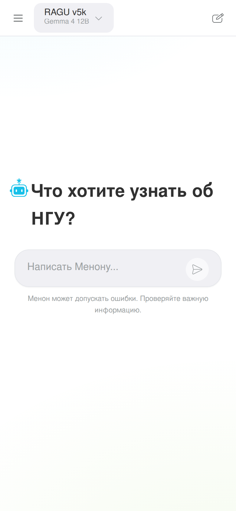 | 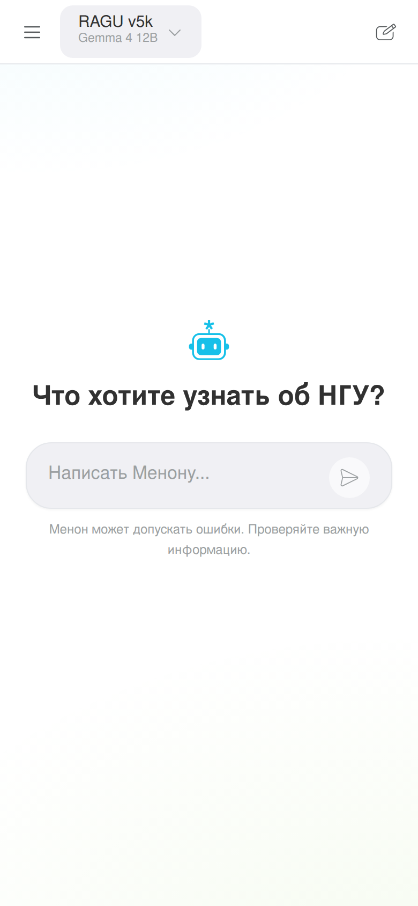 |
| 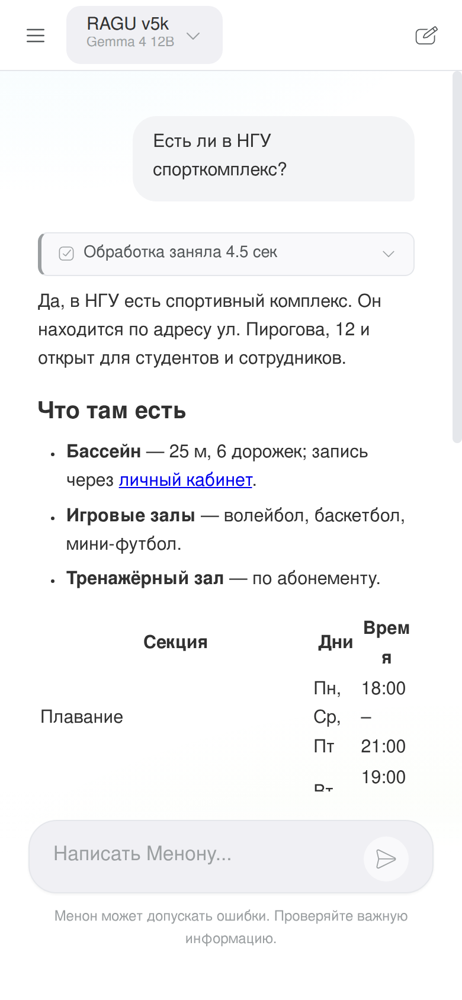 | 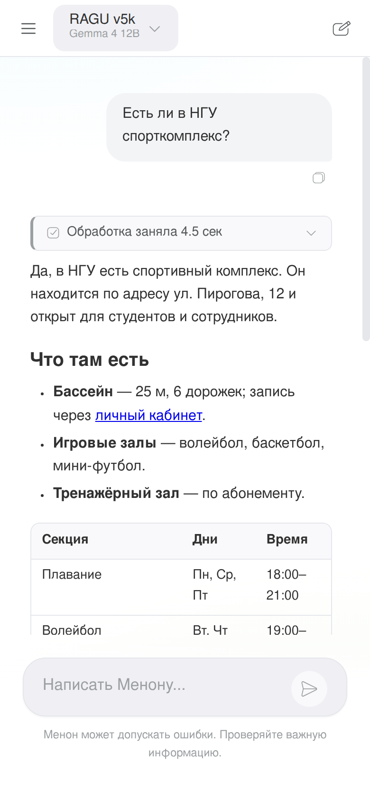 |
| 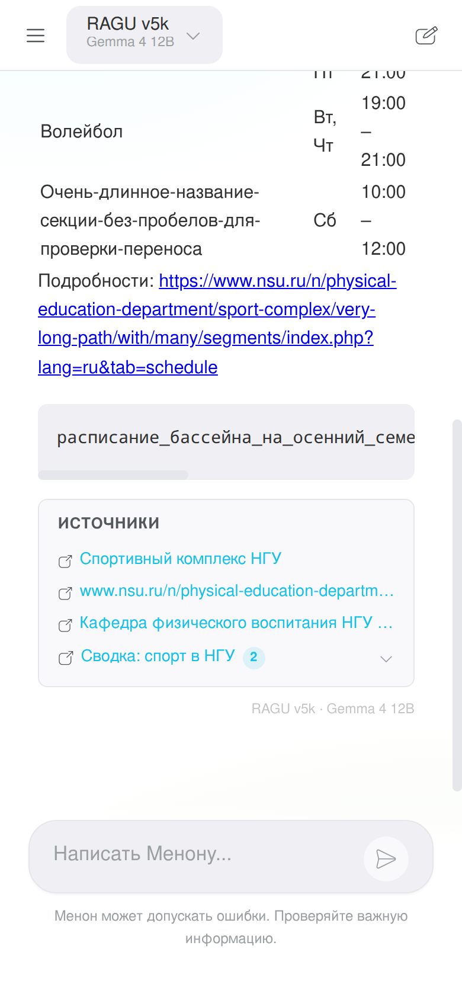 | 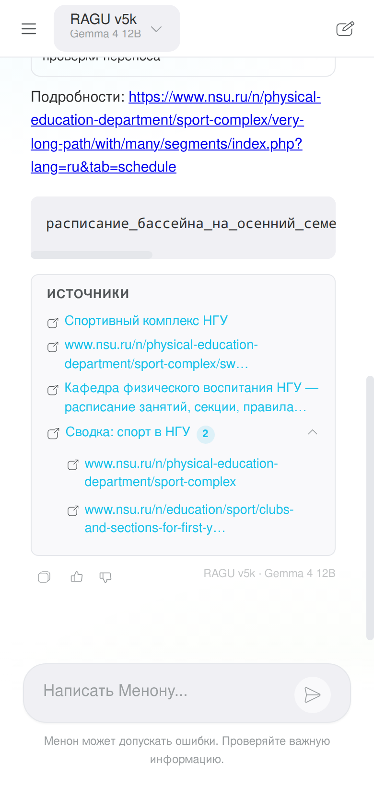 |
| 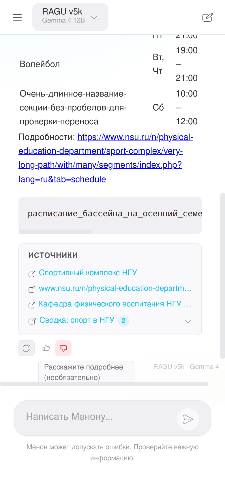 | 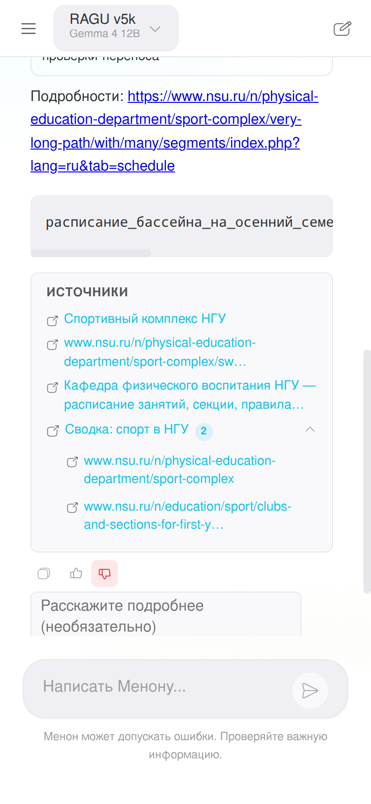 |
| 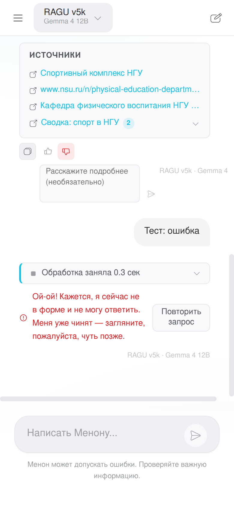 | 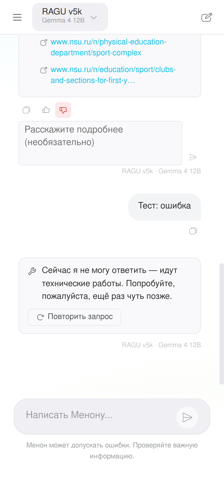 |
| 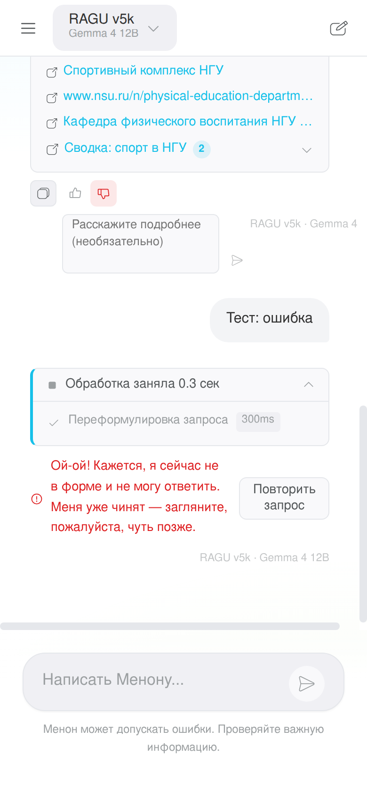 | 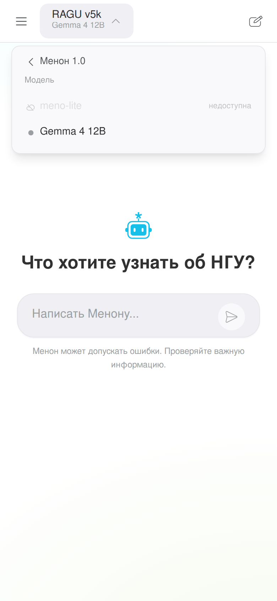 |

Последняя пара: слева — раскрытая ошибка до правки, справа — меню версий, когда бэкенд
сообщает, что meno-lite недоступна.

## Десктоп

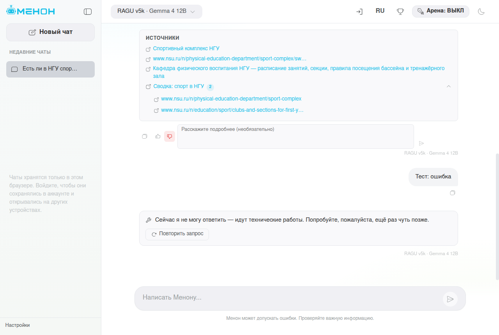
